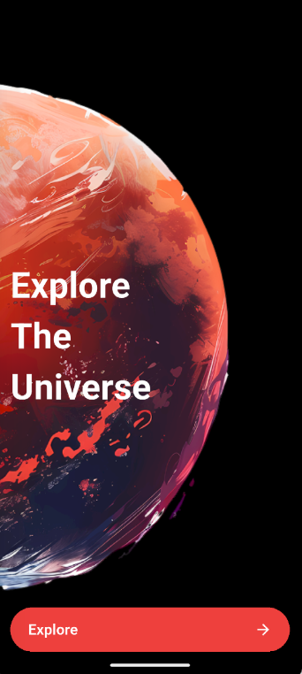
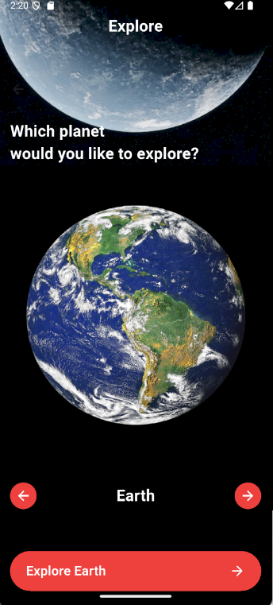
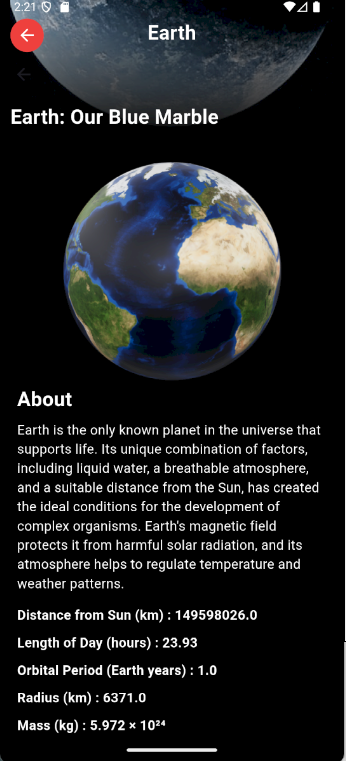

<div align="center">

## Space App

Space App is a Flutter application that lets you explore the planets of the solar system, with interactive 3D models and key facts about each planet.

</div>

## App Screens

<div align="center">
<table>
  <tr>
    <td align="center"><br><sub>Welcome Screen</sub></td>
    <td align="center"><br><sub>Home Screen</sub></td>
    <td align="center"><br><sub>Details Screen</sub></td>
  </tr>
</table>
</div>

## Features

- **Welcome Screen**
  - Full-screen planet artwork with the "Explore The Universe" title.
  - Explore button to enter the app.
- **Home Screen**
  - Planet picker with a large planet image.
  - Left and right arrows to switch between planets.
  - "Explore" button that opens the selected planet.
- **Details Screen**
  - Interactive 3D planet model that rotates automatically.
  - Short "About" description of the planet.
  - Key facts: distance from the Sun, length of day, orbital period, radius, and mass.
- **Shared UI**
  - Dark space theme with a red accent color.
  - Centralized app assets, colors, and styles.

## Architecture

The project follows a simple, organized layout:

```
lib/
├── core/
│   ├── models/
│   │   └── planets_dm.dart
│   └── utils/
│       ├── app_assets.dart
│       ├── app_colors.dart
│       └── app_styles.dart
├── features/
│   ├── welcome/
│   │   └── welcome_screen.dart
│   ├── home/
│   │   ├── widget/
│   │   └── home_screen.dart
│   └── details/
│       └── planets_details_screen.dart
└── main.dart
```

---

# 👨‍💻 Developer

<div align="center">

## Mohamed Ayman

**Flutter Developer**

Passionate about building modern, responsive, and scalable Flutter applications.

<p align="center">
<a href="https://github.com/mohamedayman891">

</a>

<a href="https://www.linkedin.com/in/mohamed-ayman09">

</a>
</p>

</div>

---